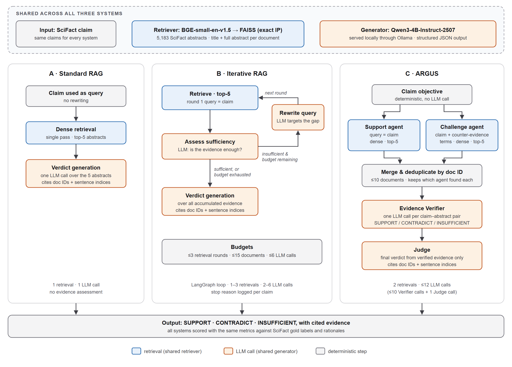

# ARGUS — Adversarial Retrieval and Grounded Understanding System

**IS469 Generative and Agentic AI | SMU | G2 Group 8 | November 2026**

ARGUS is a research project that tests whether **agentic retrieval and explicit counter-evidence search** improve scientific claim verification enough to justify their additional cost. We compare three systems on the [SciFact](https://github.com/allenai/scifact) dataset: **Standard RAG**, **Iterative RAG**, and **ARGUS**.

> **Main finding:** On 300 previously unused, labelled SciFact development claims, full ARGUS achieved **74.3% accuracy (223/300)** versus **73.3% (220/300)** for Standard RAG. The 1.0 percentage-point difference was **not statistically significant** (exact McNemar *p* = 0.788). Removing ARGUS's Challenge retrieval produced the **same number of correct verdicts**. The extra agent steps increased cost without a demonstrated accuracy improvement.

**Start here if you are grading the project:**

1. [Final experiment report](reports/argus/dev-results.md) — frozen 300-claim comparison, statistical tests, error analysis and costs.
2. [Architecture diagram](reports/argus/figures/figure1-architecture.png) — three systems and their shared components.
3. [Implementation guide](#run-the-project) — commands for setup, demo runs and reproduction.
4. [Ablation report](reports/argus/challenge-retrieval-v41-summary.md) and [robustness report](reports/argus/robustness-results.md) — investigation of why extra retrieval did not reliably help.
5. [Source code and tests](#repository-guide) — the actual pipelines, evaluation logic and validation tests.

## Research question

**Does adversarial multi-agent RAG improve the accuracy and robustness of scientific claim verification compared with one-shot and single-agent RAG, and are any gains worth the additional inference cost?**

We evaluated not only the final verdict but also evidence citations, output validity, retrieval-noise behaviour, and computational cost. A result where more agents do **not** improve accuracy is still a valid outcome of this controlled study.

## Final results

The primary evaluation uses **300 labelled claims from SciFact's official development split**. Configurations were fixed after earlier work on a **separate set of 162 claims derived from SciFact's training split**. The official SciFact *test* split was **not** used for these reported scores.

| System | Correct / 300 | Accuracy | Macro-F1 | Invalid outputs | LLM calls / claim |
| --- | ---: | ---: | ---: | ---: | ---: |
| Standard RAG | 220 | 73.3% | 0.733 | 4 | 1.0 |
| Iterative RAG | 215 | 71.7% | 0.722 | 6 | 5.1 |
| ARGUS A (no Challenge) | 223 | **74.3%** | 0.733 | 1 | 6.0 |
| ARGUS B (full) | 223 | **74.3%** | 0.732 | 0 | 6.8 |
| ARGUS B (no Verifier) | 213 | 71.0% | 0.703 | 1 | 1.0 |

**What the results mean**

- **More retrieval did not necessarily help.** Standard RAG outperformed Iterative RAG, and full ARGUS did not outperform its no-Challenge version in total correct answers.
- **The small accuracy gap is uncertain.** Full ARGUS versus Standard RAG: **+1.0 percentage point**, paired 95% bootstrap CI **−4.0 to +6.0 points**, exact McNemar *p* = **0.788**.
- **The Verifier changed evidence use.** Full ARGUS's cited-document precision against SciFact annotations was **0.570**, versus **0.400** for Standard RAG and **0.360** without the Verifier. This measures annotation overlap, **not** guaranteed semantic correctness.
- **The additional steps were expensive.** Full ARGUS averaged approximately **8,300 tokens and 28.3 seconds per claim**, versus **2,500 tokens and 12.5 seconds** for Standard RAG on the recorded NVIDIA A40 runs.

For per-class F1, confusion matrices, significance tests and limitations, see [the full final report](reports/argus/dev-results.md).

## System architecture



All systems use the same corpus, dense embedding model, FAISS index and local language model. The difference is how they gather and assess evidence.

| Approach | How it works | Main code |
| --- | --- | --- |
| **Standard RAG** | Retrieve the top five abstracts once, then make one LLM call for a verdict and citations. | [`src/argus/rag/standard.py`](src/argus/rag/standard.py) |
| **Iterative RAG** | Retrieve, ask an LLM whether evidence is sufficient, and optionally rewrite the query and search again; maximum three retrieval rounds. | [`src/argus/agents/iterative.py`](src/argus/agents/iterative.py) |
| **ARGUS** | Retrieve Support and Challenge evidence, merge and deduplicate by document ID, verify each abstract using an LLM, then ask a final LLM Judge for a cited verdict. | [`src/argus/agents/argus.py`](src/argus/agents/argus.py) |

ARGUS uses **LangGraph** for its workflow. In the default implementation, **Support and Challenge are retrieval roles**, not independent LLMs: Support searches using the claim; Challenge searches using the claim plus fixed counter-evidence terms. The **Evidence Verifier** and **Judge** make Qwen LLM calls. An optional counter-hypothesis Challenge variant adds a separate LLM call to generate its search query. All LLM roles use the **same underlying Qwen model**.

The three possible final labels are `SUPPORT`, `CONTRADICT` and `INSUFFICIENT`. Citations refer to original SciFact document IDs and **zero-based abstract sentence indices**. Retrieved text is treated as data rather than instructions, and malformed outputs or invalid citations are recorded as failures rather than silently counted as correct.

### Shared technology

| Component | Implementation |
| --- | --- |
| Dataset | SciFact, **5,183 scientific abstracts**, 809 train claims, 300 labelled dev claims, 300 unlabelled test claims |
| Document representation | Original title plus complete, ordered abstract; one indexed document per abstract |
| Embeddings | `BAAI/bge-small-en-v1.5`, pinned model revision, 384 dimensions |
| Dense search | Normalised vectors with `faiss.IndexFlatIP` (exact inner-product/cosine ranking) |
| Alternative retrieval | BM25 and hybrid Reciprocal Rank Fusion (RRF) for experiments |
| Generator | `qwen3:4b-instruct-2507-q4_K_M` through local Ollama |
| Agent orchestration | Python and LangGraph |
| Decoding | Temperature `0`, sampling top-k `40`, up to `512` output tokens, `8192` context tokens |
| Reproducibility | Seed `42`, pinned Python dependency lockfile, model/prompt/config metadata in experiment outputs |

The project studies **prompted and tool-using agent workflows**, not model fine-tuning. There is no web application or frontend in this repository.

## Run the project

Run all commands **from the repository root**. The project requires **Python 3.12** (`>=3.12,<3.13`), [uv](https://docs.astral.sh/uv/) and, for local LLM inference, [Ollama](https://ollama.com/). A CPU is sufficient for preprocessing and retrieval; local Qwen inference is substantially more practical on a GPU. The recorded final experiments used an **NVIDIA A40**.

### 1. Install dependencies and download SciFact

```bash
uv sync --locked
uv run --locked python scripts/download_scifact.py
uv run --locked python scripts/inspect_scifact.py
```

The download script installs the official SciFact release under `data/scifact/`, including `corpus.jsonl`, `claims_train.jsonl`, `claims_dev.jsonl` and `claims_test.jsonl`. The dataset and embedding caches are deliberately **not committed** to Git.

### 2. Prepare the local LLM

Install/start Ollama and obtain the **exact model tag** used by the code:

```bash
ollama pull qwen3:4b-instruct-2507-q4_K_M
ollama list
```

Ollama must be running at `http://localhost:11434` (the default endpoint). On systems where the Ollama application is not already running, start it separately with `ollama serve`. The pinned Qwen model tag and accessible Ollama service are checked before the claim-verification runs begin.

### 3. Try a single claim

```bash
uv run --locked python scripts/run_standard_rag.py --claim "Exercise increases the risk of cardiovascular disease"
uv run --locked python scripts/run_iterative_rag.py --claim "Exercise increases the risk of cardiovascular disease"
uv run --locked python scripts/run_argus.py --claim "Exercise increases the risk of cardiovascular disease" --judge-version v4.1 --verifier-version v2
```

These are **demo inputs**, not labelled evaluation cases. The commands use the respective pipelines and print the predicted verdict, citations, and run information. A demo verdict should not be taken as a medical or scientific recommendation.

For a short, labelled smoke test without touching the official dev split:

```bash
uv run --locked python scripts/run_standard_rag.py --smoke-test
uv run --locked python scripts/run_iterative_rag.py --smoke-test
uv run --locked python scripts/run_argus.py --smoke-test --judge-version v4.1 --verifier-version v2
```

These smoke tests select five deterministic claims from the **training-derived development pool**.

## Reproduce the main comparison

The following commands match the **five frozen configurations** described in the final report. Each `--evaluate --split dev` command runs **all 300 labelled SciFact development claims** and creates a new timestamped directory inside the specified `--output-dir`. These are full inference experiments, not quick smoke tests.

```bash
# Standard RAG
uv run --locked python scripts/run_standard_rag.py --evaluate --split dev --output-dir outputs/dev/rag

# Iterative RAG
uv run --locked python scripts/run_iterative_rag.py --evaluate --split dev --output-dir outputs/dev/iterative_rag

# ARGUS A: no Challenge, Verifier v2, Judge v4.1
uv run --locked python scripts/run_argus.py --evaluate --split dev --judge-version v4.1 --verifier-version v2 --no-challenge --output-dir outputs/dev/argus/A

# ARGUS B: full Support + Challenge, Verifier v2, Judge v4.1
uv run --locked python scripts/run_argus.py --evaluate --split dev --judge-version v4.1 --verifier-version v2 --output-dir outputs/dev/argus/B

# ARGUS B without the Verifier (neutral Judge wording)
uv run --locked python scripts/run_argus.py --evaluate --split dev --judge-version v4.1 --no-verifier --neutral-judge-wording --output-dir outputs/dev/argus/B-no-verifier
```

**Important:** The commands above reproduce the **experimental configurations**, not guaranteed byte-identical predictions. Original experiments used the pinned local Qwen quantisation and BGE revision, Ollama 0.40.5, seed 42 and one A40 GPU; runtime and hardware differences may change results even at temperature zero. **Do not rerun or tune on the official dev labels and then describe them as untouched held-out evaluation.**

Each completed evaluation produces:

```text
outputs/dev/<system>/<UTC-run-id>/
├── metadata.json       # model identity, configuration, selected claim IDs and run status
├── metrics.json        # accuracy, macro-F1, citation metrics and run statistics
└── predictions.jsonl   # claim-level verdicts, evidence, failures and execution traces
```

To analyse completed runs **without making additional model calls**:

```bash
uv run --locked python scripts/analyze_runs.py --split dev --run "Standard RAG=outputs/dev/rag/<run-id>" --run "ARGUS B=outputs/dev/argus/B/<run-id>"
```

Replace `<run-id>` with the directory name created by the corresponding run.

## Additional experiments

### Retrieval benchmark

```bash
uv run --locked python scripts/benchmark_retrieval.py --methods bm25 dense hybrid --k 3 5 10 --seed 42
```

This compares lexical BM25, BGE/FAISS dense retrieval and hybrid RRF on the internal train-derived validation set. Results are written to `outputs/retrieval/`. See [retrieval benchmark findings](reports/retrieval/milestone2-summary.md).

### Challenge ablations

Six variants were compared on the same **162 internal training-derived validation claims** with Judge v4.1 and Verifier v1, so only the Challenge strategy changed:

| Arm | Change to Challenge retrieval | Internal accuracy |
| --- | --- | ---: |
| A | No Challenge | **74.69%** |
| B | Original dense search with fixed counter-evidence suffix | **74.69%** |
| C | Dense search, exclude Support documents | 72.84% |
| D | BM25 lexical search | 73.46% |
| E | LLM-written counter-hypothesis query | 73.46% |
| F | Hybrid RRF search, exclude Support documents | 72.84% |

No Challenge variation beat arm A. The main Challenge retrieval analysis, including call counts, citation changes and limitations, is in [`challenge-retrieval-v41-summary.md`](reports/argus/challenge-retrieval-v41-summary.md). To reproduce one internal variant, for example BM25 Challenge:

```bash
uv run --locked python scripts/run_argus.py --evaluate --judge-version v4.1 --challenge-retrieval bm25 --challenge-query claim --output-dir outputs/ablation/bm25
```

For other arms, see the supported CLI options in [`scripts/run_argus.py`](scripts/run_argus.py), especially `--no-challenge`, `--challenge-retrieval`, `--challenge-query` and `--challenge-exclude-support`. **Do not compare the six-arm internal v1-Verifier scores directly with the final 300-claim v2-Verifier scores as if they used the same configuration.**

### Retrieval-noise robustness

The robustness study requests replacement of zero to three **non-gold** top-five retrieved abstracts with lower-ranked, real SciFact abstracts. Already retrieved gold-annotated evidence is protected. These are controlled distractor tests, **not** proof of resistance to misinformation or prompt injection.

```bash
# CPU-only protocol preflight; no LLM inference
uv run --locked python scripts/prepare_robustness.py --limit 5

# Model-backed pilot on training-derived development claims
uv run --locked python scripts/run_robustness.py --system standard --noise-level 3 --pilot 5

# Full internal-validation noise run (162 claims), original system configurations
uv run --locked python scripts/run_robustness.py --system argus --noise-level 3 --evaluate
```

The committed [robustness report](reports/argus/robustness-results.md) summarises **12 original system/noise runs** and **two separately archived ARGUS v4.1 endpoint runs**. The underlying `metadata.json`, `metrics.json` and `predictions.jsonl` for all 14 are in [`reports/argus/robustness-artifacts/`](reports/argus/robustness-artifacts/). **The current `run_robustness.py` constructs the original ARGUS configuration by default; it does not expose a flag to rerun the separately archived v4.1 endpoint experiment.**

## Evaluation rules and reproducibility

- **Labels:** `SUPPORT`, `CONTRADICT`, `INSUFFICIENT`. Claims with no SciFact-annotated evidence are operationally scored `INSUFFICIENT`; this does **not** prove the claim false.
- **Accuracy and macro-F1:** Calculated against labelled claims. Invalid or unparseable outputs remain in the denominator and count as failures.
- **Evidence quality:** Document/sentence citation precision and recall measure overlap with SciFact annotations; these annotations are not exhaustive scientific truth.
- **Agent behaviour and efficiency:** Saved traces, retrieval calls, LLM calls, tokens, timings, stop reasons, validity and error categories allow further analysis.
- **Splits:** The **162** seed-42 internal claims were used for development and prompt changes. The **300** official labelled dev claims were reserved for the final frozen comparison. SciFact's unlabelled official test split was not evaluated for the scores above.
- **No training claims:** Verifier v2 and Judge v4.1 are **prompt/validation changes**, not LoRA or parameter fine-tuning.

**Artifact availability:** This source archive includes report summaries and the **14 raw robustness runs**, but **not the five original `outputs/dev/` prediction directories**. `outputs/` is Git-ignored by design. The five-run final metrics and run IDs are documented in [`reports/argus/dev-results.md`](reports/argus/dev-results.md); rerun the frozen commands above for new raw predictions. To enable independent verification of the *original* 300-claim predictions, provide the original `outputs/dev/` directories separately.

## Repository guide

| Location | Contents |
| --- | --- |
| [`src/argus/rag/`](src/argus/rag/) | Standard RAG, verdict/citation validation and output artifacts |
| [`src/argus/agents/`](src/argus/agents/) | Iterative RAG, ARGUS graph, agent prompts and component logic |
| [`src/argus/retrieval/`](src/argus/retrieval/) | Dense BGE/FAISS, BM25, hybrid RRF and retrieval contracts |
| [`src/argus/llm/`](src/argus/llm/) | Ollama client and optional OpenAI provider |
| [`src/argus/evaluation/`](src/argus/evaluation/) | Splits, scoring, evidence metrics, robustness and offline run analysis |
| [`src/argus/data/`](src/argus/data/) | SciFact loaders, schemas and dataset validation |
| [`scripts/`](scripts/) | Download, benchmark, main experiment and analysis entrypoints |
| [`reports/argus/`](reports/argus/) | Final evaluation, ablations, error audits and robustness evidence |
| [`reports/argus/figures/`](reports/argus/figures/) | Architecture image and editable draw.io source diagrams |
| [`tests/`](tests/) | Automated tests for loading, retrieval, pipelines, evaluation and providers |
| [`pyproject.toml`](pyproject.toml), [`uv.lock`](uv.lock) | Python dependencies and locked versions |

### Code quality checks

```bash
uv run --locked pytest -q
uv run --locked ruff check .
uv run --locked ruff format --check .
```

These are local automated checks; full model-backed experiments require the dataset and an accessible inference service.

## Limitations and scope

Results are specific to **SciFact**, a **quantised 4B generator**, and the recorded experimental environment. The 300-claim comparison cannot establish tiny differences with confidence, and prompt revisions informed by the internal 162 claims may overfit that set. A more complex system can retrieve more papers without finding more usable evidence, and even structurally valid citations may not support the scientific conclusion. Outputs should be treated as research predictions requiring human review, **not authoritative medical advice**.

**Research conclusion:** In this evaluated setting, ARGUS did **not** demonstrate a reliable accuracy improvement over the simpler Standard RAG baseline. Its Verifier improved citation selectivity, while explicit Challenge retrieval added cost without an observed overall accuracy benefit.
